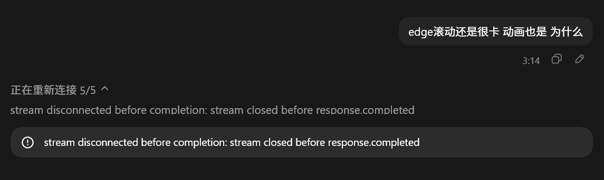

## 来源与状态

- 原文标题：一招教你修复 Codex 客户端总是重新连接 Reconnecting 5/5的解决办法
- 作者：[代码简单说](https://blog.csdn.net/weixin_41961749)
- 来源：[CSDN 原文](https://blog.csdn.net/weixin_41961749/article/details/162218153)
- 发布日期：2026-06-23；更新日期：2026-07-04（据网页文章元数据）。
- 归档日期：2026-11-02。
- 内容类型：外部技术资料，附 AI 摘要；保存不代表本人认可，不属于已确认个人认知。
- 标签：Codex、Reconnecting、WebSocket、HTTPS Streaming、SSE、Responses API、config.toml、代理。

本文归档原文讨论的重连现象、传输方式与配置示例，供检索参考。原文的源码解释、配置适用版本及修复效果未独立核验，文中“实测”为作者自述。

## AI 摘要

以下为 AI 对原文的概括，不是本人观点，也不是独立验证后的排障结论。

- **现象**：每次开启对话时出现多次 `Reconnecting`，重试后仍可能正常回答。
- **作者的解释**：部分网络环境能够正常访问 HTTPS，却无法稳定建立 WebSocket；作者认为反复重试后回退到 HTTPS Streaming 可以解释这类现象。
- **作者提供的方案**：在 `~/.codex/config.toml` 中选择自定义的 `openai_http` provider，保留 `wire_api = "responses"`，并设置 `supports_websockets = false`。完整配置见下方原文“修改 Codex 配置”。
- **原文的代理示例**：在 `~/.codex/.env` 中设置 `ALL_PROXY=http://127.0.0.1:7890`，端口需对应实际代理服务。
- **作者偏好 HTTPS 的理由**：便于观察请求上下文和工具调用，并认为它对不同服务商更具兼容性。

## 原文存档

【外部资料｜[一招教你修复 Codex 客户端总是重新连接 Reconnecting 5/5的解决办法](https://blog.csdn.net/weixin_41961749/article/details/162218153)】

以下保留文章正文的文字、代码、表格与链接，仅将网页排版转换为 Markdown，移除网页交互标记；配图已转存到本站。下文第一人称及判断均属于原作者。

## 一招教你修复 Codex 客户端总是重新连接 Reconnecting的解决办法

---

**SEO关键词：** Codex Reconnecting、Codex重连5次、Codex WebSocket、Codex Responses API、Codex配置教程、supports_websockets、Codex HTTPS Streaming、Codex连接失败解决方法、OpenAI Codex教程、Codex源码分析



## Codex客户端下载

如果你还没有安装 OpenAI Codex 客户端，可以前往：

| 软件 | 下载地址 |
| --- | --- |
| Codex客户端 | [https://codexdown.cc/](https://codexdown.cc/) |

### 前言

你的 Codex 在回答之前有没有出现过这样的情况？

```text
Reconnecting...
Reconnecting... (2/5)
Reconnecting... (3/5)
Reconnecting... (4/5)
Reconnecting... (5/5)
```

有时候明明最后还是能够正常回答，但每次开启新对话都要先重连几次，等待十几秒甚至几十秒，非常影响使用体验。

很多人第一反应是：

- OpenAI 服务器太忙
- 网络不稳定
- 模型响应太慢
- API 出问题

实际上很多情况下都不是。

这个问题的根源，往往是 **Codex 新版本优先启用了 WebSocket 连接，而你的网络环境无法稳定建立 WebSocket 通道。**

这篇文章带大家从源码层面分析问题，并给出实测有效的解决方案。

---

### 一、先搞清楚 Codex 的请求链路

当你在 Codex 输入一句话时：

```text
用户
 ↓
Codex Client
 ↓
Responses API
 ↓
OpenAI Backend
 ↓
模型返回结果
```

但这里有一个很多人不知道的细节：

同样都是 Responses API，底层其实有两种传输方式。

#### 方式一：HTTPS Streaming

也就是传统的 HTTP POST + SSE。

流程大概是：

```text
客户端
    ↓ POST
服务器

服务器
    ↓ SSE
持续返回内容
```

这种方式也是目前：

- Claude Code
- Cherry Studio
- Open WebUI
- 大部分 AI 客户端

最常用的方案。

---

#### 方式二：WebSocket

2026 年 OpenAI 在 Responses API 中加入了 WebSocket 支持。

简单理解：

```text
建立一次连接

客户端 ←→ 服务器

持续交换数据
```

相比 HTTPS：

- 延迟更低
- 不需要频繁建立连接
- 更适合 Agent 场景
- 更适合长时间持续交互

OpenAI 官方工程文章也专门介绍过这个方案：

```text
Speeding up agentic workflows with WebSockets in the Responses API
```

---

### 二、为什么会出现 Reconnecting？

问题就出在这里。

很多软件或者网络环境：

```text
HTTPS 正常
≠
WebSocket 正常
```

例如：

- 企业网络
- 校园网
- 某些机场节点

都可能出现：

```text
HTTPS 能访问

wss:// 建立失败
```

于是 Codex 每次启动对话都会：

```text
尝试 WebSocket
      ↓
连接失败
      ↓
重试
      ↓
重试
      ↓
重试
      ↓
重试
      ↓
放弃
      ↓
切换 HTTPS
      ↓
正常回答
```

于是你就看到了：

```text
Reconnecting...
Reconnecting...
Reconnecting...
```

最后居然还能正常使用。

因为最终已经回退到了 HTTPS。

---

### 三、Codex 源码是怎么实现的？

关键逻辑在：

```rust
client.rs
```

中的：

```rust
stream()
```

函数。

逻辑大致如下：

```rust
if wire_api == Responses {
    if responses_websocket_enabled() {
        使用 WebSocket
    } else {
        使用 HTTPS Streaming
    }
}
```

也就是说：

第一层判断：

```rust
wire_api
```

是否为：

```rust
responses
```

如果是，则继续判断：

```rust
responses_websocket_enabled()
```

---

### 四、WebSocket 是否启用由谁决定？

继续跟进去：

```rust
responses_websocket_enabled()
```

会发现里面最关键的判断：

```rust
supports_websockets
```

简化后逻辑如下：

```rust
if supports_websockets == false {
    return false;
}
```

另外还有一个条件：

```rust
session.disabled_websocket
```

如果前面已经连续失败过：

```rust
disabled_websocket = true
```

那么后续也会直接禁用。

所以实际上控制权就在：

```rust
supports_websockets
```

这个配置项上。

---

### 五、解决方案：直接禁用 WebSocket

既然问题已经定位到了：

```text
WebSocket 建立失败
```

那么解决方案就非常简单：

**不要让 Codex 尝试 WebSocket。**

直接强制走 HTTPS Streaming。

---

#### 修改 Codex 配置

打开：

```text
~/.codex/config.toml
```

加入下面配置：

```toml
model_provider = "openai_http"

[model_providers.openai_http]
name = "OpenAI HTTP"

wire_api = "responses"

requires_openai_auth = true

supports_websockets = false
```

---

#### 配置说明

##### wire_api

```toml
wire_api = "responses"
```

表示：

```text
继续使用 Responses API
```

不会影响模型能力。

---

##### supports_websockets

```toml
supports_websockets = false
```

这是关键。

它会让：

```rust
responses_websocket_enabled()
```

直接返回：

```rust
false
```

然后进入：

```text
HTTPS Streaming
```

分支。

从而彻底跳过：

```text
WebSocket
↓
连接失败
↓
Reconnecting
```

这一整套流程。

---

### 六、用户还需要配置 .env

如果你本身需要访问 OpenAI。

建议在：

```text
~/.codex/.env
```

中加入：

```bash
ALL_PROXY=http://127.0.0.1:7890
```

Linux / macOS 可直接执行：

```bash
echo "ALL_PROXY=http://127.0.0.1:7890" >> ~/.codex/.env
```

根据自己的端口修改即可：

例如：

```text
7890
10809
20171
```

等等。

---

### 七、为什么我更喜欢 HTTPS 模式？

我自己长期研究 Codex 工作原理，因此更倾向于 HTTPS。

主要有两个原因。

#### 原因一：更容易分析请求

HTTPS 模式下：

```text
每次请求
↓
完整上下文
↓
发送给服务器
```

因此可以很方便观察：

- Prompt 变化
- Context 变化
- Tool Call 内容
- Token 使用情况

---

#### 原因二：兼容性更好

目前国内大模型厂商适配情况大多是：

```text
Chat Completions API
```

部分支持：

```text
Responses API
```

但支持：

```text
Responses API + WebSocket
```

的其实并不多。

因此对于：

- DeepSeek
- Qwen
- GLM
- Kimi
- SiliconFlow

等生态来说，

HTTPS 依然是最通用、最稳定的方案。

---

### 八、实测效果

修改配置前：

```text
Reconnecting...
Reconnecting...
Reconnecting...
Reconnecting...
Reconnecting...
```

等待十几秒后才开始回答。

---

修改配置后：

```text
用户发送消息
↓
直接进入 Responses API
↓
立即返回内容
```

基本不再出现：

```text
Reconnecting
```

的问题。

---

### 九、总结

如果你的 Codex 经常出现：

```text
Reconnecting...
```

并且连续重连 5 次后又能正常工作，

那么问题大概率不是模型慢，也不是服务器忙，而是：

```text
WebSocket 连接失败
```

最简单的解决办法：

#### 1. 禁用 WebSocket

```toml
supports_websockets = false
```

#### 2. 保持 Responses API

```toml
wire_api = "responses"
```

#### 3. 配置

```bash
ALL_PROXY=http://127.0.0.1:7890
```

这样 Codex 会直接使用 HTTPS Streaming，不再反复尝试建立 WebSocket 连接，从而彻底解决启动对话时频繁出现的 Reconnecting 问题。
