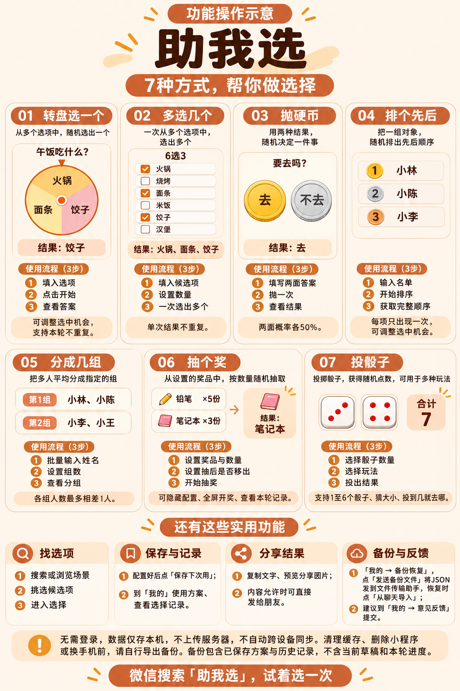

我的第一款微信小程序——「助我选」，正式上线了！

午饭吃什么，周末去哪儿，几个选项纠结半天？让它帮你选一次。老师分组、给学生发奖，朋友聚会，也都能用上。

*功能操作示意，具体设置与规则以小程序内实际页面为准。*

## 七种方式，帮你做选择

**1. 转盘选一个**：填入候选项，转动转盘选答案。可调整选中机会，开启本轮不重复抽取。适合决定吃什么、看哪部电影。

**2. 多选几个**：输入候选项和所需数量，一次选出多个，单次结果不重复。适合抽选课堂答题同学、挑选几项周末活动。

**3. 抛硬币**：把两个答案填在硬币两面，抛一次，各有一半机会。适合在两家餐厅、两种聚会方案间做选择。

**4. 排个先后**：批量输入名单，随机排序，每项只出现一次。适合安排课堂展示、游戏出场顺序。

**5. 分成几组**：粘贴姓名、设置组数，即可随机分组，各组人数最多相差一人。适合课堂讨论、团建和聚会分队。

**6. 抽个奖**：填写奖品和数量，设置抽后是否移出；支持隐藏配置、全屏开奖和本轮记录。适合学生领取小奖励、聚会抽礼物。

**7. 投骰子**：选择1至6个骰子，支持猜大小、按总点数决定去第几站。适合桌游、聚会小游戏和随机探索出行。

## 保存方案，也别忘了备份

常用配置可保存为方案；结果自动记录，可复制文字或生成图片分享。想不到选项，还能从内置分类里找灵感。

请记住：无需登录，方案和记录仅存本机，不上传服务器、不自动跨设备同步。清理缓存、删除小程序或换手机可能丢失数据，请提前在「我的 → 备份恢复」导出文件，另行保存。备份不包含当前草稿和本轮进度。

## 去微信里试试

欢迎在微信搜索「助我选」体验！有建议或遇到问题，请通过「我的 → 意见反馈」告诉我。
