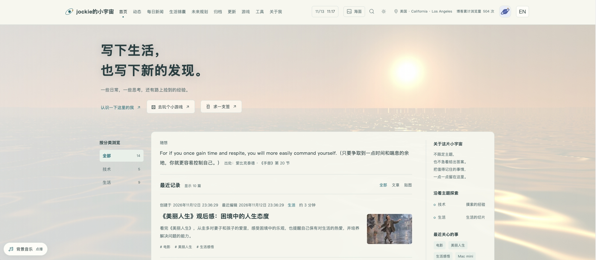
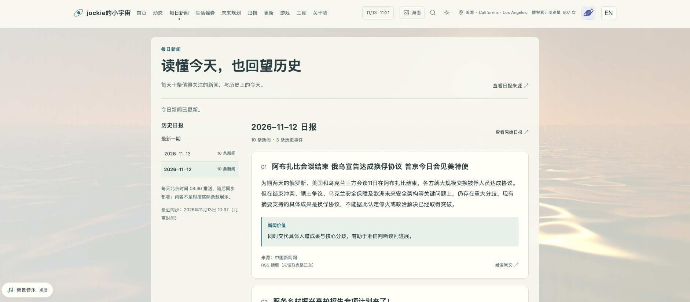
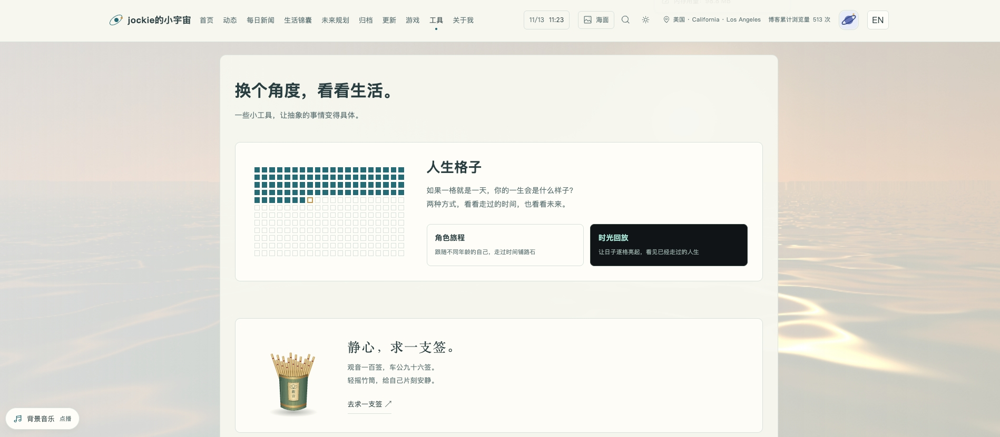
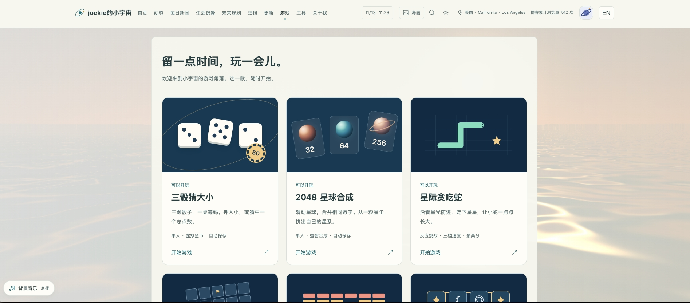

我想做一个“人生系统”的系列，并且记录自己是怎么把这些东西一点点搭起来的。目前想到的有个人博客、人生教练系统、投资系统，还有一个百宝箱。博客用来记录想法和生活；人生教练系统，希望能帮我理清一些困惑；投资系统用来整理资料、记录自己的判断；百宝箱就放平时收集的工具和方法，遇到问题时可以翻一翻。

其他几个后面再慢慢写。这篇先聊聊现在这个博客，「jockie 的小宇宙」。

## 为什么还要自己搭一个博客？

现在能发内容的平台已经很多了，为什么还要折腾一个博客？对我来说，一个原因是想留下些记录，另一个原因，是不太想被流量影响。

在自媒体平台上发东西，发布前觉得自己只是想分享一下，发出去后，还是会忍不住看阅读量。看到别人的流量好，再看看自己的，就开始想：为什么我的这么低？哪里没写好？有时候平台还会帮你分析流量不好的原因。本来没那么在意，看完反而更在意了。这大概有一点“社会比较”的心理，也有对别人认可的期待。说白了，就是容易拿自己的反馈跟别人比。道理知道，但轮到自己，还是会受影响。

所以想给自己搭一个博客。想写什么就写什么，记录自己的想法，留下一点痕迹。有人看到、愿意聊几句，当然很好；没什么人看，写的时候也能少一些顾虑，不用总琢磨这句话发出去会被怎么理解。

还有一个重要原因：可以自己折腾。平台提供什么功能，我们就用什么。自己的博客不一样，想加动态背景、背景音乐，或者放个小游戏，都可以试试。把脑子里冒出的想法一一实现，这件事真的很有趣。

## 用什么搭的？

一台电脑就可以。我原来用 Windows，现在换成了 Mac mini。主要的工具是 VS Code、Codex CLI 和 GitHub。VS Code 用来打开项目、看文件；Codex CLI 负责帮我写代码、改功能、处理报错；GitHub 保存代码和文章，也负责后面的发布。访问这些服务时，我还会用到网络代理。另外用了 Superpowers，给 AI 提供一些梳理需求、开发和检查的工作流程。它是开发时用的，读者打开博客不需要安装这些东西。

整个搭建过程都交给 AI，一行代码都不需要懂，也不用自己写。我做的就是把想法描述给它，然后打开页面看看效果。比如想让首页有动态背景，就告诉它想要什么效果；做出来不喜欢，再接着改。文章分类、手机布局、搜索、小游戏，也都是这样一点点加上去的。

中间遇到工具不会安装、代码推不上去，或者页面报错，就直接问 AI，让它帮忙解决。Node.js、npm 这些名字看不懂也没关系，不知道是什么、有什么用、下一步怎么操作，都可以接着问，让它用自己能听懂的话解释。不用先学完编程再开始，遇到不懂的就问。做出来之后，我主要看是不是自己想要的，不合适就继续提、继续改。

## 没有服务器，怎么部署？

这里用的是 GitHub Pages，不需要我自己买服务器。文章保存成 Markdown 文件，也就是 `.md` 文件。写好后，连同网站代码一起推送到 GitHub，GitHub Actions 就会运行检查，再用 Astro 把文章和页面模板生成网页，最后发布到 Pages。

平时更新的流程就是：写文章或修改功能 → 推送到 GitHub → 自动检查、构建 → 发布到博客。

网站的主要页面是提前生成好的，所以叫静态网站。背景动画、音乐和小游戏这些交互，到了浏览器里再运行，不影响它采用这种部署方式。

评论则借用了 giscus，内容实际保存在 GitHub Discussions。动态、生活锦囊、未来规划和每日新闻也用了 Discussions，再由自动任务把内容同步到博客。这样省去了自己维护数据库和服务器的麻烦，不过也有更新延迟，后面会说到。

## 现在都有哪些功能？

整理了一下，已经加了不少。

### 文章、贴图和动态

长一点的内容写成文章，支持目录、图片、表格和代码高亮。想发几张图、配一些文字，就用贴图，上方可以左右滑动看图。零碎的想法可以放在“动态”里，不用为了几句话专门写一篇文章。动态能搜索正文和回复，也能按日期筛选、翻页。

文章有分类、子分类、标签和日期归档，首页可以组合筛选，也有分页。创建时间和最近编辑时间会分别显示。想找以前写过什么，可以用全文搜索，部分工具和游戏入口也能搜到。

文章和贴图下面可以评论，动态也可以回复，需要登录 GitHub 账号。习惯用阅读器的话，还可以通过 RSS 订阅文章。没写完的内容先放在文稿箱里，准备进入文章目录的内容也可以设成草稿，确认后再发布。

### 动态背景和音乐

首页有星系漫游、极光之境、日落海面三种背景，可以手动选，也会根据日期自动搭配。开场有粒子汇聚和星门开启两种效果，可以跳过，也可以重播。文章页面的背景是静态的，读长文时清爽一些。

背景音乐有三首，默认关闭。想听的时候打开，可以切歌、调音量、拖动进度。网站还可以切换深浅色，关闭动态效果，或者切换中英文界面。英文主要是导航和功能提示，文章本身不会自动翻译。

### 每日新闻、随想和日历

“每日新闻”用来集中看整理好的日报，有摘要、来源和相关说明，也能翻以前的日期。这里展示的是同步进来的内容，不是博客自己实时抓取新闻。

首页的“随想”每天展示一句话，目前收录了 500 条中外名句，附有作者和出处。导航里放了北京时间和月历，可以翻月、跳到指定年月，也有元旦和农历新年的倒计时。

### 生活锦囊和未来规划

“生活锦囊”放一些实用经验，或者遇到问题时找到的解决办法，方便以后查找。

“未来规划”记录接下来想做的事情。可以填类型、内容、计划时间，再标成待开始、进行中或已完成，支持搜索、类型筛选和按状态排序。头像菜单里还有通知，会提醒到期未完成的规划，以及近三天没读过的日报。

### 人生格子、求签和小游戏

人生格子有“角色旅程”和“时光回放”两个版本。输入出生日期和自己设定的预计寿命，就能看到已经走过的时间和剩余的格子，也可以写寄语、生成图片。这里的寿命只是自己填的假设，日期和寄语在浏览器里计算，不上传。

求签有观音一百签和车公九十六签，可以摇签、看签诗和解读，最近的记录保存在当前浏览器。

小游戏目前有六个：三骰猜大小、2048 星球合成、星际贪吃蛇、星域扫雷、星际打砖块、星图连连看。电脑和手机都有相应的操作方式，部分进度和成绩可以保存在本机。猜大小用的是虚拟金币。

### 其他一些功能

“关于我”放个人介绍，“功能专区”记录博客每次增加、修复和优化了什么。页面还有文章阅读量、全站累计浏览量和访客网络出口 IP 的大致归属地。浏览量用的是不蒜子，统计的是页面访问次数，不是读者人数。手机适配、返回顶部、分享信息、站点地图和 404 页面这些基础功能，也都做了。

## 仓库里也加了一些检查

提交前会做一次代码 review，主要检查这几件事：

- 功能有没有出问题，文章和配图能不能正常查看。
- 有没有误发密码、私人信息或草稿。
- 修改说明和检查结果有没有留下，方便以后回头查。

## 用下来，有哪些不足？

最直接的是访问。以我目前的网络环境，还是需要代理，给别人分享链接时就没那么方便。评论等外部服务有时也会加载得比较慢。

另外，没有自建数据库，数据就得分开放。文章、图片和代码在项目文件与 GitHub 仓库里；评论、动态、规划和日报等在 Discussions；阅读量在不蒜子；游戏记录和一些偏好则在浏览器本地。这意味着换个设备，游戏进度不会自动跟过来，清理浏览器数据也可能把记录一起清掉。以后如果想做账号和跨设备同步，还得另外想办法。

动态、规划和新闻也不是发完就马上出现在列表里。它们要等同步、构建和部署，有时候讨论区已经能看见，页面列表还没更新。虽然有自动任务，但不能保证每次都在固定时间内完成。

评论需要 GitHub 账号，对不用 GitHub 的朋友来说，也多了一道门槛。

还有，博客和相关 Discussion 都是公开空间，有些私人记录不适合放在这里。文章设成草稿，只是不会发布到博客页面；文件如果进了公开仓库，仍然能被看到。

目前这些问题还不影响我继续用，暂时也没有为了它们再搭一套后台的打算。

## 后面还想做什么？

功能上目前已经比较满意了，接下来主要就是用起来，记录想法，记录自己。有新的点子，就先记到“未来规划”里，之后再看要不要做。

这篇也算是分享一点自己搭建博客的思路，给有兴趣的朋友做个参考。大家也可以把 AI 用起来，搭一个属于自己的博客，想写什么、想加什么功能，都可以试试。

博客地址：[jockie 的小宇宙](https://jockiepeng.github.io/my-universe/)，欢迎光临寒舍～
